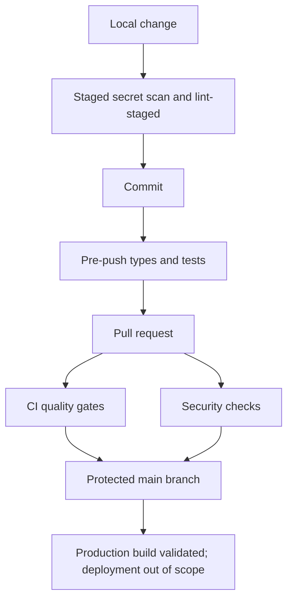

# Architecture

The sample App Router page consumes `getCards()`, a mock content provider. `normalizeCard()` is a runtime validation boundary where a future Sitecore Content SDK adapter can map fields into presentation models. This intentionally avoids SDK or tenant dependencies and is not a claim of SDK compatibility.

Local hooks are fast feedback, not a security boundary. CI performs independent checks with read-only repository permissions. No pull_request_target workflows, deployment credentials, or cloud resources are used. Production smoke tests start a locally built server on the runner.

The security workflow separates history scanning, dependency review, and CodeQL. CodeQL workflow success means analysis completed; it does not by itself mean zero findings. Configure code scanning merge protection where supported.

For production adoption, pin third-party actions to reviewed full commit SHAs and the Gitleaks container to a verified digest. This starter uses version tags for readability and maintainability; those tags are not immutable. Apply updates through reviewed Dependabot PRs.
